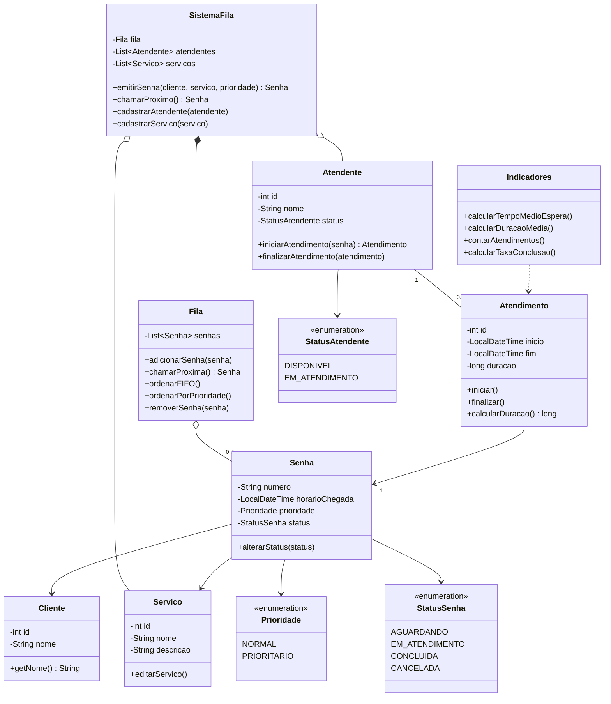

# Chamaê — Sistema de Gerenciamento de Filas e Atendimentos

<p align="center">
  <strong>Sua vez, sem complicação.</strong>
</p>

## Sobre o projeto

O **Chamaê** é um sistema desktop desenvolvido como Projeto Integrador da faculdade, com o objetivo de facilitar a organização e o gerenciamento de filas de atendimento presencial.

A aplicação permitirá controlar a emissão de senhas, acompanhar pessoas aguardando atendimento, gerenciar atendentes e serviços, além de aplicar diferentes critérios de organização de filas.

O projeto tem como cenário inicial clínicas, consultórios e estabelecimentos de saúde, mas poderá ser adaptado para outros segmentos que trabalham com atendimento presencial.

## Objetivo

Desenvolver uma aplicação desktop capaz de centralizar o gerenciamento de filas e atendimentos, tornando o processo mais organizado e eficiente.

O sistema busca solucionar problemas comuns, como:
- Falta de organização na ordem de atendimento.
- Dificuldade para controlar filas prioritárias.
- Falta de acompanhamento dos atendimentos.
- Distribuição desigual entre atendentes.
- Ausência de indicadores sobre o desempenho das filas.

## Funcionalidades

### 1. Gerenciamento de senhas
- Emissão automática de senhas.
- Identificação do tipo de serviço.
- Registro do horário de chegada.
- Definição de prioridade de atendimento.

### 2. Controle de filas
- Visualização das senhas aguardando atendimento.
- Organização por ordem de chegada (FIFO).
- Organização por prioridade.
- Chamada da próxima senha.
- Atualização do status dos atendimentos.

### 3. Gerenciamento de atendentes
- Cadastro de atendentes.
- Edição e exclusão de registros.
- Controle de disponibilidade.
- Identificação de atendentes em atendimento.

### 4. Gerenciamento de serviços
- Cadastro de tipos de atendimento.
- Edição e exclusão de serviços.
- Associação dos serviços às senhas emitidas.

### 5. Indicadores
- Quantidade de atendimentos concluídos.
- Tempo médio de espera.
- Duração média dos atendimentos.
- Taxa de conclusão dos atendimentos.

### 6. Simulação de filas
- Simulação de organização FIFO.
- Simulação de atendimento por prioridade.
- Comparação dos resultados entre diferentes estratégias.

## Tecnologias utilizadas

| Tecnologia | Aplicação |
|---|---|
| Java | Linguagem principal |
| Java Swing | Desenvolvimento da interface gráfica |
| Graphics2D | Personalização dos elementos visuais |
| POO | Organização e estruturação do código |

## Diagrama UML

O diagrama abaixo representa a estrutura geral de classes planejada para o Chamaê, demonstrando suas principais entidades, atributos, métodos e relacionamentos.



## Lógica de funcionamento

O Chamaê contará inicialmente com duas estratégias principais de organização de filas.

### FIFO (First In, First Out)

O primeiro atendimento que entra na fila é o primeiro a ser chamado, respeitando a ordem de chegada.

### Atendimento por prioridade

Atendimentos classificados como prioritários poderão ser chamados antes dos atendimentos normais, seguindo os critérios estabelecidos pelo sistema.

Essas estratégias permitirão comparar diferentes formas de organização e observar seus impactos no tempo de espera.

## Disciplinas integradas

O projeto busca integrar conhecimentos de diferentes disciplinas do semestre:

| Disciplina | Aplicação no projeto |
|---|---|
| Programação Orientada a Objetos | Criação de classes, objetos, métodos e relacionamentos. |
| Circuitos Digitais | Aplicação de lógica booleana nas regras de prioridade. |
| Fundamentos Matemáticos | Cálculo de médias, porcentagens e tempos de atendimento. |
| Sistemas Operacionais | Estudo de escalonamento e organização de tarefas. |

## Estrutura do projeto

A estrutura inicial de organização do código será:

```text
Chamae/
│
└── src/
    ├── model/
    │   ├── Cliente.java
    │   ├── Senha.java
    │   ├── Fila.java
    │   ├── Atendente.java
    │   ├── Servico.java
    │   └── Atendimento.java
    │
    ├── enums/
    │   ├── Prioridade.java
    │   ├── StatusSenha.java
    │   └── StatusAtendente.java
    │
    ├── controller/
    │   ├── SistemaFila.java
    │   └── Indicadores.java
    │
    └── view/
        ├── MenuPrincipal.java
        ├── FilaTela.java
        ├── EmitirSenhaTela.java
        ├── AtendentesTela.java
        └── IndicadoresTela.java
```

*Observação: a estrutura poderá sofrer alterações durante o desenvolvimento.*

## Público-alvo

O sistema tem como cenário inicial clínicas, consultórios e laboratórios de pequeno e médio porte.

Entretanto, sua estrutura poderá ser adaptada para outros estabelecimentos que necessitam organizar filas e atendimentos presenciais.

## Limites do projeto

- A aplicação será desenvolvida para desktop.
- Não dependerá de totens, sensores ou equipamentos físicos.
- Não terá como objetivo substituir prontuários eletrônicos ou sistemas médicos.
- Os dados utilizados nas demonstrações poderão ser fictícios.
- As estimativas de espera serão informativas, não garantias de horário.

## Status do projeto

**Em desenvolvimento — Projeto Integrador**

O Chamaê está em fase de planejamento e desenvolvimento acadêmico. As funcionalidades descritas representam o escopo previsto para a primeira versão do sistema.

## Equipe de desenvolvimento

Projeto desenvolvido por estudantes do segundo semestre, como parte das atividades do Projeto Integrador.

- **Instituição:** [Senai Fatesg]
- **Curso:** [Engenharia de Software]
- **Integrantes:** [Gabriel Vinhal, Guilherme Ferreira, João Gabriel e Rafael Santos]

---

<p align="center">
   <strong>Chamaê</strong><br>
  Sua vez, sem complicação.
</p>
